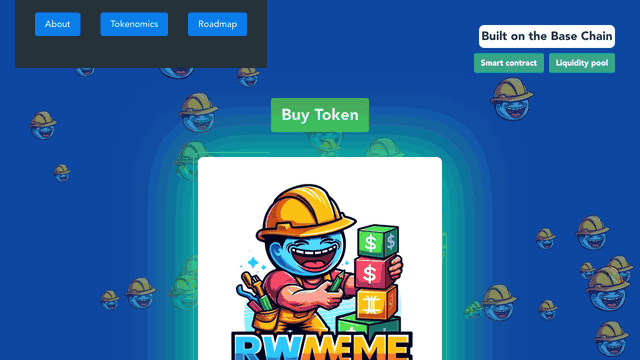

# RWAMEME — Real World Asset Meme



Landing page for **RWAMEME**, a meme token on the [Base](https://base.org) chain. It is a single-page React app with an animated particle background, smooth-scroll navigation, and About, Tokenomics and Roadmap sections.

- **Smart contract (Base):** [`0x6E8B5Cb8DCba2301E5c3112292db4C6637d9459f`](https://basescan.org/address/0x6e8b5cb8dcba2301e5c3112292db4c6637d9459f#code) (verified source on BaseScan)
- **Liquidity pool / buy:** [Uniswap (Base)](https://app.uniswap.org/swap?inputCurrency=ETH&outputCurrency=0x6E8B5Cb8DCba2301E5c3112292db4C6637d9459f&chain=base)

> Nothing in this repository is financial advice. Meme tokens are highly speculative.

## Tech stack

| Purpose | Library |
| --- | --- |
| UI | [React 18](https://react.dev) |
| Build / dev server | [Vite 8](https://vite.dev) with [`@vitejs/plugin-react-swc`](https://github.com/vitejs/vite-plugin-react) |
| Styling | [styled-components 6](https://styled-components.com) |
| Background animation | [tsParticles 2](https://particles.js.org) (`react-tsparticles` and per-feature plugins) |
| Section navigation | [react-scroll](https://github.com/fisshy/react-scroll) |

## Getting started

Requires **Node.js 20.19+ or 22.12+** (Vite 8's minimum). The repo pins Node 22 in `.nvmrc`.

```bash
nvm use
```

```bash
npm install
```

```bash
npm run dev
```

The dev server runs at <http://localhost:5173>.

### Scripts

| Command | What it does |
| --- | --- |
| `npm run dev` | Starts the Vite dev server with hot reload |
| `npm run build` | Builds the production bundle into `dist/` |
| `npm run preview` | Serves the built `dist/` locally to check the production build |

## Project structure

```
.
├── index.html                 # HTML entry, page title and favicon
├── vite.config.js             # Vite config (React SWC plugin)
└── src/
    ├── main.jsx               # React root
    ├── App.jsx                # Page layout: nav, buy button, hero card, sections
    ├── index.css / App.css    # Global styles and the LT Score @font-face
    ├── assets/                # Meme images (.webp)
    ├── fonts/lt-score/        # LT Score font files
    └── components/
        ├── NavigationMenu/        # Top menu, scrolls to sections
        ├── LandingPageCard/       # Hero card with the mascot
        ├── Buttons/
        │   ├── BuyButton/             # Opens Uniswap in a new tab
        │   └── LinkToContractButton/  # Opens the contract on BaseScan
        ├── Sections/
        │   ├── AboutSection/
        │   ├── TokenomicsSection/
        │   └── RoadMapSection/
        └── ParticleComponents/    # tsParticles wrapper and option presets
```

Each component keeps its styled-components in a `styledComponents.js` file next to the `.jsx` file.

### Customising

- **Buy, smart contract and liquidity pool links:** `src/App.jsx` (`BuyButton` and the buttons under "Built on the Base Chain"). The contract address shown in Tokenomics is in `src/components/Sections/TokenomicsSection/TokenomicsSection.jsx`.
- **Section copy:** the matching component in `src/components/Sections/`.
- **Particle background:** `src/components/ParticleComponents/`. The `options*.js` files hold alternative presets; `Particles.jsx` picks which one is used.

## Deployment

`npm run build` produces a static site in `dist/` that any static host can serve, for example GitHub Pages, Netlify, Vercel or Cloudflare Pages. The build command is `npm run build` and the output directory is `dist`.

For GitHub Pages under `https://<user>.github.io/rwameme/`, set `base: '/rwameme/'` in `vite.config.js` before building.

## Continuous integration

`.github/workflows/build.yml` runs on every push to `main` and on pull requests. It installs dependencies with `npm ci`, fails on any moderate-or-higher `npm audit` finding, and runs the production build.
